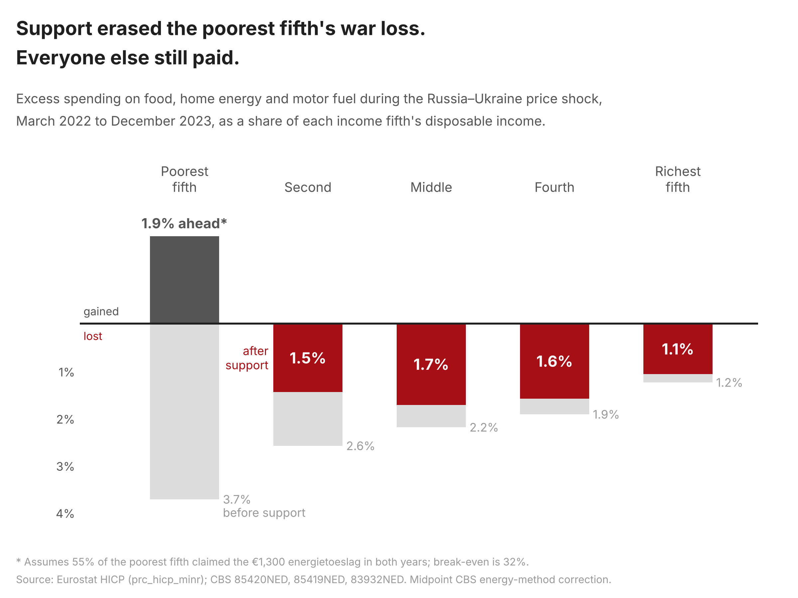

# Are there human casualties in the Netherlands from the wars in Ukraine and Iran?

<div dir="rtl">هل يوجد ضحايا بشرية في هولندا بسبب الحرب في أوكرانيا والآن في إيران؟</div>

No bombs fell on the Netherlands, but both wars reached Dutch kitchens and meter cupboards. Between March 2022 and December 2023, the Russia–Ukraine price shock cost the average household about €1,900 in excess spending on food, home energy and motor fuel. That is €15.5 billion nationally. Government support returned €5.9 billion of it, and it did not land evenly.



The poorest fifth lost 3.7% of its income before support and ended up 1.9% ahead after it, assuming 55% of those households claimed the €1,300 energietoeslag in both years. Below 32% take-up they would still have lost. Everyone above them paid between 1.1% and 1.7% of income. Measured against spending rather than income, the shock was close to flat: every fifth lost between 2.7% and 3.1% of what it spent. Most of the apparent regressivity comes from the bottom fifth spending a third more than its registered income.

Turned into life expectancy with the Dutch income–longevity gradient, the Ukraine shock cost the equivalent of 113 full 82-year lifetimes after support (plausible range 45 to 226), and support prevented about 72 more. That is 0.19 days per resident. Six months into the Iran war the bill is €78 per household, almost all of it motor fuel, and the life-years equivalent is 3. Household energy prices have not moved yet.

Figures as of August 2026 prices. The charts and `reports/key_numbers.json` refresh monthly; the prose here does not. The full argument, with every assumption and its weak points, is in [reports/report.md](reports/report.md), and a referee-style critique of the project is in [reports/review.md](reports/review.md).

## How to reproduce

```bash
git clone https://github.com/akramvanahmed-projects/122347.git && cd 122347
pip install -r requirements.txt
python -m warcost all          # fetch, analyse, draw figures
streamlit run app.py           # interactive version
```

`fetch` downloads Eurostat and CBS tables (about 10 MB, cached in `data/raw/`). `analyse` writes per-quintile summaries and a sensitivity grid to `data/processed/`, and the numbers quoted above to `reports/key_numbers.json`. The processed data is committed, so `analyse`, `figures` and the app also work offline. `pytest` runs the model checks against synthetic inputs with known answers. A GitHub Action refreshes the data on the 3rd of every month.

## Layout

```
config.yaml              every source pointer and assumption, with ranges
src/warcost/             sources, prices, exposure, health, analysis, figures
data/external/           CBS energy-method research series (transcribed)
data/processed/          model inputs and outputs (committed)
figures/                 PNG (300 dpi) and SVG
reports/                 report.md, key_numbers.json
notebooks/               walkthrough.ipynb
app.py                   Streamlit dashboard
tests/                   pytest
```

## Data and licence

Code is MIT-licensed (see `LICENSE`). Data comes from Eurostat (HICP, `prc_hicp_minr`) and Statistics Netherlands (StatLine tables 85420NED, 85419NED and 83932NED, plus published figures on energy poverty and life expectancy), all reused under CC BY 4.0. Source: CBS and Eurostat. The results are this project's own modelling, not official statistics.
